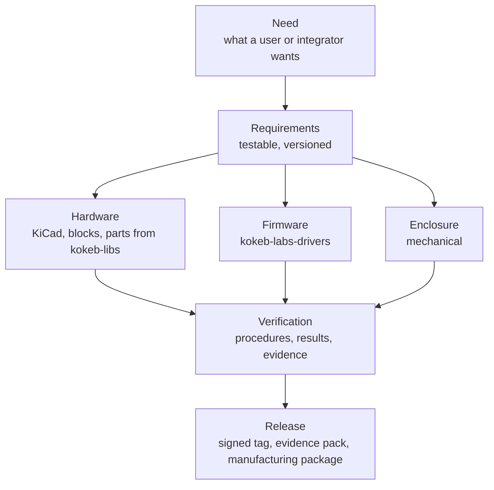

<picture>
  <source media="(prefers-color-scheme: dark)" srcset="https://raw.githubusercontent.com/kokeb-labs/.github/main/brand/mark/mark-dark.svg">
  
</picture>

# Kokeb Labs Open Boards

Open development boards built around the [Kokeb Labs drivers](https://github.com/kokeb-labs-drivers): each board is
designed in KiCad, documented from its requirements down to its test results, and shipped with the driver and example
firmware that runs it. Use one as a bench kit, as a reference design, or as the starting point for your own product.

*Kokeb (ኮከብ) means "star" in Amharic.*

> **Early days.** The organisation, the template and the first board are being set up. Nothing here has been
> manufactured or verified on hardware yet; each board's `board.yml` says where it stands.

## How a board is made

Each arrow is a link you can follow in the repositories, from what people need down to the part on the board:

Requirements, risks and verifications are data in each board's `trace/` folder, linked by version. When a need or a
chip choice changes, every requirement and test that depends on it is flagged in the same pull request, and CI fails
until someone has reviewed it. Nothing is copied by hand.

## Repositories

| Repository | What it is |
| --- | --- |
| [`board-bmp581-breakout`](https://github.com/kokeb-labs-open-boards/board-bmp581-breakout) | The first board: a breakout for the BMP581 pressure sensor and its driver. Concept stage |
| [`kokeb-libs`](https://github.com/kokeb-labs-open-boards/kokeb-libs) | KiCad symbols, footprints and 3D models, each with a review status and a datasheet reference |
| [`kokeb-blocks`](https://github.com/kokeb-labs-open-boards/kokeb-blocks) | Reusable circuit blocks (power, interfaces, sensor front ends) that boards are assembled from |
| [`board-template`](https://github.com/kokeb-labs/board-template) | Start a new board: record, trace, checks, CI |

## What every board meets

| | |
| --- | --- |
| **Traced** | Needs, requirements, risks and verifications linked by version; the check runs in CI |
| **Built on the drivers** | Pins, supply ranges and reference circuits follow the driver's `hardware.yml` and the datasheet revision it names |
| **Honest about status** | `board.yml` states the status, the revision and the intended use; nothing is called verified without evidence |
| **Reviewed** | A person who did not draw it signs off the schematic and the layout |
| **Open** | Public repositories; software and documentation MIT; the hardware licence is decided before the first release |

These boards are evaluation and development kits for people who build their own products. They are not medical
devices and are not intended for diagnostic, therapeutic or patient-connected use. A release carries an
[evidence pack](https://github.com/kokeb-labs/board-template/blob/main/docs/evidence-pack.md) that an integrator can
use in their own design file; it supports their process and does not replace it.

## Where things live

| | |
| --- | --- |
| [Kokeb Labs](https://github.com/kokeb-labs) | The platform: CI, templates, the engineering standard, the portal |
| [Kokeb Labs Drivers](https://github.com/kokeb-labs-drivers) | The C++20 chip drivers the boards are built around |
| [Handbook](https://kokeb-labs.github.io/handbook/) | The rules every repository follows, with the check that verifies each |

Questions and ideas go to [Discussions](https://github.com/orgs/kokeb-labs-open-boards/discussions). Report
vulnerabilities privately as the
[security policy](https://github.com/kokeb-labs-open-boards/.github/blob/main/SECURITY.md) describes, never in a
public issue.
